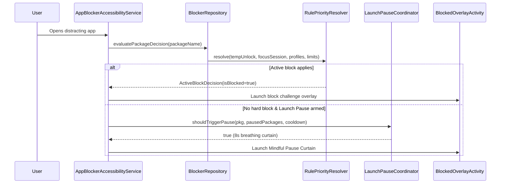

# Architecture

FocusNest follows **Clean Architecture + MVVM** with unidirectional data flow and zero `INTERNET` permission:

- `domain.model`: Pure Kotlin business logic (`RulePriorityResolver`, `UnlockChallengeEngine`, `LaunchPauseCoordinator`, `FocusTimeUtils`, `BedtimeChecklistDefaults`, `UpdateReleaseConfig`, domain enums). Zero Android framework imports so domain rules verify quickly on the JVM.
- `core.audio`: `AmbientSoundEngine` coroutine PCM synthesizer rendering `BROWN_NOISE`, `SOFT_RAIN`, `WARM_DRONE`, and `STUDY_MURMUR` offline via `android.media.AudioTrack`.
- `core.database`: Room SQLite database (`FocusNestDatabase`, version 2) with 21 entities (`HabitEntity`, `HabitCompletionEntity`, `CategoryLimitEntity` included), indexed DAOs returning `Flow<T>`, JSON `TypeConverters`, and non-destructive `MIGRATION_1_2`.
- `core.datastore`: `FocusNestPreferences` managing theme, 6 accent palettes, English/Hindi language selection, ambient soundscape choice & volume, launch-pause configuration, date-scoped bedtime wind-down progress, per-app VPN network scope, Pomodoro config, Invincible Mode state, and reboot-persistent epoch + `elapsedRealtime()` timer state.
- `core.common`: Portable AES-256-GCM (`PBKDF2WithHmacSHA256`) backup crypto, Android Keystore helper, ZXing offline QR generator, SHA-256 token verification, and OEM compatibility guidance.
- `core.permissions`: `PermissionManager` inspecting `AppOpsManager`, `Settings.Secure`, `VpnService.prepare`, `NfcAdapter`, `PowerManager`, Android Display / Night Light shortcuts, and external browser `ACTION_VIEW` intents for GitHub Releases.
- `data.repository`: `UsageStatsRepository`, `BlockerRepository`, `FocusRepository`, `HabitRepository`, and `InsightsAndBackupRepository` (including the styled printable HTML/PDF report card builder).
- `service` & `widget`: `FocusTimerService` (integrated with `AmbientSoundEngine`), `AppBlockerAccessibilityService` (integrated with `LaunchPauseCoordinator`), `FocusNestVpnService`, `FocusNotificationService`, `FocusQuickTileService`, `FocusUsageMonitorWorker`, `BootCompletedReceiver`, and 3 `AppWidgetProvider` classes.
- `core.design` & `feature.*`: Responsive Jetpack Compose Material 3 components (`AdaptiveTwoPane`, List-Detail `MoreScreen`, `NavigationRail` on `Medium`/`Expanded` widths) across `home`, `focus`, `blocker`, `insights`, `habits`, `more`, `challenges`, and `onboarding`, driven by `FocusNestViewModel` and `collectAsStateWithLifecycle()`.

