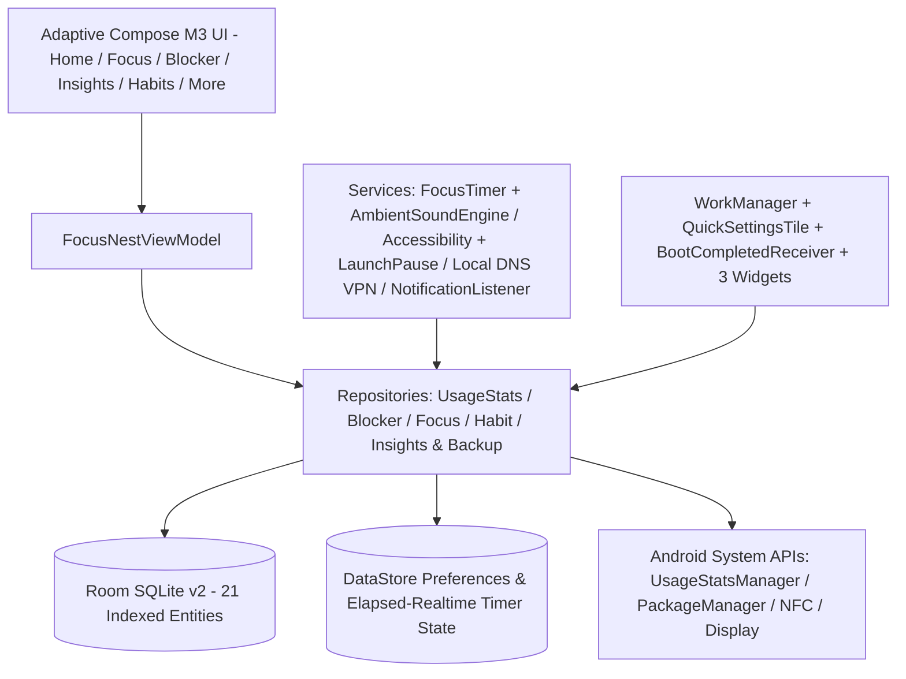

<div align="center">
  
  <h1>FocusNest</h1>
  <p><strong>Own Your Time. Protect Your Focus.</strong></p>
  <p>
    <a href="https://github.com/OWNER/FocusNest/actions/workflows/android-ci.yml"></a>
    <a href="https://github.com/OWNER/FocusNest/actions/workflows/release.yml"></a>
    <a href="https://github.com/OWNER/FocusNest/actions/workflows/deploy-pages.yml"></a>
    <a href="LICENSE"></a>
    
    
  </p>
</div>

**FocusNest** is a 100% free, MIT open-source, privacy-first, offline-first Android digital wellbeing application built with Kotlin, Jetpack Compose, Material 3, Room SQLite, DataStore, and WorkManager.

---

## Core Principles

- **100% Free & Open Source** — Every feature unlocked under the MIT License: no paywalls, no ads, no subscriptions.
- **Zero-Internet & Zero Trackers** — `AndroidManifest.xml` intentionally omits `android.permission.INTERNET`. All telemetry stays on your device.
- **Transparent Optional Permissions** — `PACKAGE_USAGE_STATS`, `AccessibilityService`, `VpnService`, `NotificationListenerService`, `CAMERA`, and `NFC` are optional and requested strictly when needed.
- **Zero-Internet Update Handoff** — Checking for updates in **More → Settings** opens [`OWNER/FocusNest` Releases](https://github.com/OWNER/FocusNest/releases/latest) in your external browser cleanly without adding network permissions to FocusNest.

---

## What's New in v1.2.0

- **Adaptive Tablet & Foldable Two-Pane UI** — `AdaptiveTwoPane` and List-Detail canonical layouts across Home, Focus, Blocker, Insights, Habits, and More (`720.dp+` widths + `NavigationRail`).
- **Offline Ambient Focus Soundscapes** — Pure-Kotlin coroutine `AudioTrack` PCM synthesis (`Brown Noise`, `Soft Rain`, `Warm Drone`, `Study Wash`) built directly into Focus sessions.
- **Mindful App-Launch Pause Curtain** — Optional `5s–15s` breathing pause curtain before armed distracting apps open, with a 5-minute proceed cooldown (`LaunchPauseCoordinator`).
- **Weekly PDF / Printable Wellbeing Report Card** — Styled offline HTML-to-PDF summary featuring goal attainment badges, categories, top apps, and reflection logs.
- **Evening Wind-Down Checklist & System Shortcuts** — Daily auto-resetting bedtime checklist alongside direct shortcuts to Android Display Brightness and Night Light / Grayscale settings.
- **Zero-Internet Browser Release Checker** — Clean update checking via `Intent.ACTION_VIEW` to `https://github.com/OWNER/FocusNest/releases/latest`.

---

## Architecture Overview



---

## Showcase Website & Documentation Index

| Resource | Purpose |
| :--- | :--- |
| [Interactive Showcase (`website/`)](website/index.html) | Live 5-tab interactive phone preview + Light/Dark & accent theme switcher |
| [Feature Catalog](FEATURES.md) | Complete list of digital wellbeing, focus, blocker, habit & wind-down features |
| [Technical Architecture](ARCHITECTURE.md) | Clean Architecture + MVVM modules, Room v2, monotonic timer & pause flows |
| [Privacy Policy](PRIVACY.md) & [Threat Model](THREAT_MODEL.md) | Zero-internet guarantees & data boundary explanations |
| [Security Policy](SECURITY.md) & [Permissions](PERMISSIONS.md) | AES-256-GCM backups, manifest audit, and minimal permission model |
| [Build Guide](BUILD.md) & [Testing Guide](TESTING.md) | Gradle build commands, Robolectric + Compose UI suite, and Lint checks |
| [Docs Hub](docs/README.md) | Deep-dive guides on App Blocking, Local VPN, QR/NFC, and OEM compatibility |
| [Changelog](CHANGELOG.md) | Release notes for `v1.2.0`, `v1.1.0`, and `v1.0.0` |

---

## Quick Start (Build & Verify)

```bash
# Run full unit & Robolectric Compose test suite
gradle :app:testDebugUnitTest

# Run Android Lint & privacy checks
gradle :app:lintDebug

# Build debug APK
gradle :app:assembleDebug
```

> Public GitHub repositories replace `OWNER/FocusNest` with your fork or organization slug in badges, release URLs, and GitHub Pages settings. See [`.github/workflows/`](.github/workflows/) for CI, tagged releases with `SHA256SUMS.txt`, and automatic Pages deployment.
