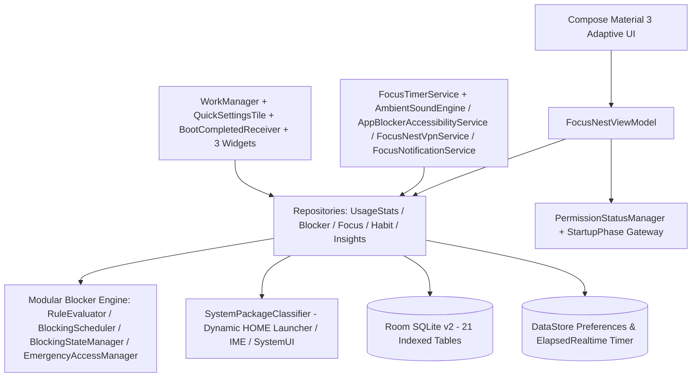

<div align="center">
  
  <h1>FocusNest</h1>
  <p><strong>Own Your Time. Protect Your Focus.</strong></p>
  <p>
    <a href="https://github.com/SudhirDevOps1/FocusNest/actions/workflows/android-ci.yml"></a>
    <a href="https://github.com/SudhirDevOps1/FocusNest/actions/workflows/website-ci.yml"></a>
    <a href="https://github.com/SudhirDevOps1/FocusNest/actions/workflows/codeql.yml"></a>
    <a href="https://github.com/SudhirDevOps1/FocusNest/actions/workflows/android-release.yml"></a>
    <a href="LICENSE"></a>
    
    
    
  </p>
  
</div>

<br/>

**FocusNest** is a **100% free**, **MIT open-source**, **offline-first** Android digital wellbeing, app blocker, focus sanctuary, and habit tracking application engineered by **Sudhir Kumar** ([`@SudhirDevOps1`](https://github.com/SudhirDevOps1)) using Kotlin, Jetpack Compose Material 3, Room SQLite, DataStore, WorkManager, CameraX, ZXing, and Android VpnService.

> **Interactive Showcase Website:** [https://sudhirdevops1.github.io/FocusNest/](https://sudhirdevops1.github.io/FocusNest/)
> **Download Latest Releases:** [SudhirDevOps1/FocusNest Releases](https://github.com/SudhirDevOps1/FocusNest/releases/latest)

---

## Core Privacy & Open-Source Principles

- **100% Free Forever** — Zero subscriptions, zero paywalls, zero ads, and zero locked premium tiers under the [MIT License](LICENSE).
- **Zero-Internet App Guarantee** — `app/src/main/AndroidManifest.xml` intentionally omits `android.permission.INTERNET`, structurally guaranteeing zero background telemetry or cloud leaks, enforced in CI on every push and PR.
- **Zero-Internet Release Checker** — Tapping **More → Settings → Check Releases on GitHub** delegates an explicit browser `Intent.ACTION_VIEW` to [`SudhirDevOps1/FocusNest/releases/latest`](https://github.com/SudhirDevOps1/FocusNest/releases/latest) without adding network code inside FocusNest.
- **Launcher & System-Safe Analytics** — `SystemPackageClassifier` dynamically queries your active `CATEGORY_HOME` launcher, SystemUI, enabled keyboards, and permission controllers to keep distraction statistics clean by default (with a **Show system & launcher apps** toggle in Insights, Blocker, and Settings).
- **Anti-Lockout Safety** — No invasive Device Administrator locks; owner recovery and emergency dialer/contacts access always stay safe.

---

## Key Features (`v1.2.0`)

- **Deterministic Startup & Permission Gateway**: `StartupPhase` (`INITIALIZING → FIRST_RUN / ONBOARDING / READY / RECOVERY`) with versioned DataStore completion prevents onboarding loops on cold start, adds a **Replay Onboarding Tutorial** button in Settings, and tracks runtime vs. special access permissions with Android 13+ sideloaded Restricted Settings guidance and revocation alerts.
- **Focus Sanctuary & Offline Procedural Audio**: Pomodoro, Countdown, and Stopwatch modes with monotonic `SystemClock.elapsedRealtime()` timer restoration across process kills/reboots, paired with pure-Kotlin `AudioTrack` PCM synthesis (`Brown Noise`, `Soft Rain`, `Warm Drone`, `Study Wash`).
- **Modular App Blocker Engine**: `RuleEvaluator`, `BlockingScheduler`, `BlockingStateManager`, `EmergencyAccessManager`, and `FocusUsageMonitorWorker` `UsageEvents` fallback protecting app/group/category limits, grace windows, `Study`/`Work`/`Sleep`/`Reading`/`Weekend` profiles, and 80%/90%/100% threshold warnings.
- **Mindful App-Launch Pause Curtain**: Optional `5s–15s` guided breathing buffer before opening distracting apps with a 5-minute proceed cooldown (`LaunchPauseCoordinator`).
- **12 Friction Unlock Challenges**: `Breathing 4-2-4 Orb`, `Adaptive Math (with division)`, `Sentence Typing`, `Personal Intention`, `Signed One-Time/Timed QR Scan`, `Barcode Scan`, `NFC Tag Tap`, `Cooldown Wait`, `Temporary Unlock`, `Daily Unlock Limit`, `Reflection Pause`, and `Strict Mode`.
- **Stride-Safe CameraX QR/Barcode & NFC Vault**: Hardware stride-safe `YuvLuminanceExtractor`, lifecycle `DisposableEffect` cleanup, flashlight toggle, retry/error states, SHA-256 replay-protected tokens, and physical NFC tag triggers.
- **Local On-Device DNS Website Blocker (`VpnService`)**: Finite state machine (`DISCONNECTED` → `CONNECTING` → `CONNECTED` / `ERROR`), allowlist > blocklist resolution, per-app tunnel scoping, and a live **Verify Domain Rule Matching** card inside the Blocker screen (with honest Private DNS / DoH disclosures).
- **Screen Time Insights, Weekly PDF Report Card & Encrypted Backups**: Real `UsageStatsManager` daily/weekly/monthly analytics, HTML-escaped offline Printable/PDF Wellbeing Report Card, CSV/JSON export, and PBKDF2WithHmacSHA256 + AES-256-GCM backups.
- **Offline Habits & Evening Wind-Down Checklist**: Habit streaks, 7-day completion strips, scheduled Do Not Disturb, daily auto-resetting Bedtime Wind-Down Checklist, and Android Display Brightness / Night Light shortcuts.
- **Adaptive Phones, Foldables, Tablets & ChromeOS UI**: Bottom `NavigationBar` on phones seamlessly transitions to `NavigationRail`, `AdaptiveTwoPane`, and List-Detail screens on `720.dp+` displays with 6 accent palettes, Material You Dynamic Color, and live English / Hindi (`values-hi`) switching.

---

## Architecture Overview



---

## Documentation & Showcase Navigation

| Resource | Description |
| :--- | :--- |
| [Interactive 27-Section Showcase (`website/`)](website/index.html) | Live 5-tab phone preview, searchable 10-category feature gallery, DNS rule simulator & Light/Dark + 4-palette switcher |
| [Production Audit & Bug Report](docs/audit/BUG_REPORT.md) | Baseline findings `FN-001`–`FN-009`, root causes, fixes, tests & resolution status |
| [Repository Audit](docs/audit/REPOSITORY_AUDIT.md) & [CI/CD Audit](docs/audit/CI_CD_AUDIT.md) | Codebase architecture audit & GitHub Actions hardening findings |
| [Feature Status Matrix](docs/audit/FEATURE_STATUS.md) & [Feature Catalog](FEATURES.md) | Honest engineering verification across every capability |
| [Architecture](ARCHITECTURE.md) & [Database Schema](DATABASE.md) | Clean Architecture MVVM, Room v2, monotonic timers & engine flow |
| [Privacy Policy](PRIVACY.md), [Security](SECURITY.md) & [Threat Model](THREAT_MODEL.md) | Zero-internet structural guarantee, AES-256-GCM backups & supply-chain security |
| [Permissions](PERMISSIONS.md) & [Android Compatibility](ANDROID_COMPATIBILITY.md) | Runtime vs. special access, Android 8–16 quirks & OEM battery setup |
| [Build Guide](BUILD.md), [Installation](INSTALLATION.md) & [Testing](TESTING.md) | Gradle build/APK/AAB commands, Robolectric + Compose UI suite & lint |
| [Docs Deep-Dive Hub](docs/README.md) | Guides for App Blocking, Usage Tracking, Local VPN, QR/NFC & Troubleshooting |
| [Changelog](CHANGELOG.md), [Roadmap](ROADMAP.md) & [Contributing](CONTRIBUTING.md) | Version history, upcoming milestones & contributor checklist |

---

## Quick Start (Verify & Build Locally)

```bash
git clone https://github.com/SudhirDevOps1/FocusNest.git
cd FocusNest

# Run full unit & Robolectric Compose UI test suite
gradle :app:testDebugUnitTest

# Run Android Lint verification
gradle :app:lintDebug

# Build Debug & Release APKs
gradle :app:assembleDebug :app:assembleRelease
```

---

## Author & License

Created and maintained by **Sudhir Kumar** ([`@SudhirDevOps1`](https://github.com/SudhirDevOps1)) under the [MIT License](LICENSE).
