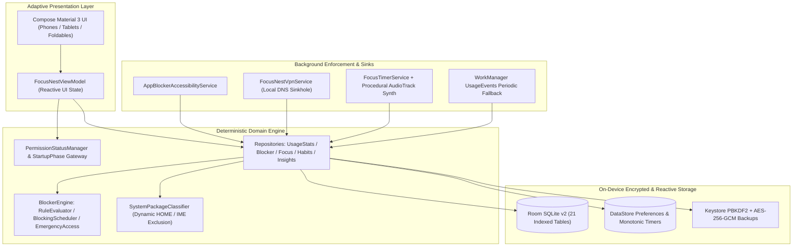

<div align="center">
  
  
  # FocusNest
  
  ### *Own Your Time. Protect Your Focus.*
  
  **An offline-first, zero-telemetry Android focus sanctuary, mindful app blocker, and wellbeing tracker.**

  <p align="center">
    <a href="https://github.com/SudhirDevOps1/FocusNest/actions/workflows/android-ci.yml"></a>
    <a href="https://github.com/SudhirDevOps1/FocusNest/actions/workflows/deploy-pages.yml"></a>
    <a href="https://github.com/SudhirDevOps1/FocusNest/releases"></a>
    <a href="LICENSE"></a>
    
    
    
    
    
  </p>

  <p align="center">
    <a href="https://sudhirdevops1.github.io/FocusNest/"><strong>Explore Interactive 27-Section Showcase Website »</strong></a>
    <br />
    <a href="#key-architectural-pillars">Architecture</a> •
    <a href="#core-features-at-a-glance">Features</a> •
    <a href="#12-friction-unlock-challenges">Unlock Challenges</a> •
    <a href="#quick-start--local-builds">Quick Start</a> •
    <a href="https://github.com/SudhirDevOps1/FocusNest/releases">Download APK</a>
  </p>

  <br/>

  
</div>

<br/>

---

## Executive Summary

**FocusNest** is a 100% free, MIT-licensed, offline-first Android application designed to give you sovereignty over your attention without trading your privacy. Built natively with **Kotlin**, **Jetpack Compose Material 3**, **Room SQLite**, and **DataStore**, it completely omits the `android.permission.INTERNET` manifest declaration, guaranteeing zero trackers, zero cloud dependencies, and zero data leakage.

Engineered by **Sudhir Kumar** ([`@SudhirDevOps1`](https://github.com/SudhirDevOps1)) with a clean architecture pattern separating pure domain logic, background Android services, and reactive UI states.

---

## Key Architectural Pillars



### 1. Structural Zero-Internet Guarantee
`app/src/main/AndroidManifest.xml` intentionally does not declare `android.permission.INTERNET`. The OS itself forbids socket connections, eliminating risk of covert data exfiltration. Every pull request and release build is verified against this constraint via an automated CI gate.

### 2. Monotonic Timer State Machine
Timer durations rely on `SystemClock.elapsedRealtime()` backed by DataStore persistence, preventing users from cheating Pomodoro intervals by changing system clock time, and ensuring timers resume seamlessly across reboots and process recreation.

### 3. Dynamic Launcher & Keyboard Safeguards
`SystemPackageClassifier` queries `PackageManager` at runtime to detect active home launchers (`CATEGORY_HOME`), default virtual keyboards (IMEs), and critical Android system UI packages, automatically filtering them out of distraction rankings to prevent false lockout loops.

### 4. Zero-Leak Local DNS Sinkhole
The on-device VPN service operates entirely in user-space using a lightweight local DNS parser. Distracting domains receive instantaneous local `NXDOMAIN` responses without intercepting, proxying, or relaying general traffic.

---

## Core Features at a Glance

| Category | Highlights & Capabilities | Documentation |
| :--- | :--- | :---: |
| **Focus Sanctuary** | Pomodoro (25/5), Countdown & Stopwatch with monotonic clock restoration across reboot; pure-Kotlin procedural `AudioTrack` PCM ambient soundscape (*Brown Noise*, *Soft Rain*, *Warm Drone*). | [Focus Guide](docs/feature-guides.md) |
| **Mindful Launch Pause** | 5s–15s animated breathing curtain before opening distracting apps, prompting mindful reflection with an automatic 5-minute proceed cooldown. | [Usage Guide](docs/USAGE_TRACKING.md) |
| **Modular App Blocker** | App, group, and category-level daily quotas, scheduled time windows, grace periods, emergency bypass passcode, and 80%/90%/100% notification warnings. | [Blocker Engine](docs/audit/FEATURE_STATUS.md) |
| **Local DNS Blocker** | On-device VPN sinkhole with allowlist > blocklist precedence, per-app tunneling, and an interactive domain rule testing simulator. | [Vpn Architecture](docs/audit/ANDROID_COMPATIBILITY.md) |
| **12 Friction Challenges** | Breathing Orb, Math Challenge, Sentence Typing, Intention Journaling, QR/Barcode Scanner, NFC Vault, Cooldown Lock, and Strict Mode. | [Challenges Guide](docs/feature-guides.md) |
| **CameraX & NFC Vault** | Stride-safe `YuvLuminanceExtractor` for QR/barcode scanning, flashlight toggle, error states, and physical NFC token registration. | [Security Audit](docs/audit/SECURITY_AUDIT.md) |
| **Insights & Analytics** | Real `UsageStatsManager` hourly/daily screen time, launch frequency, distraction rankings, and exportable offline PDF/Printable Report Cards. | [Usage Tracking](docs/USAGE_TRACKING.md) |
| **Encrypted Backups** | Full Room database and preferences backup secured with PBKDF2WithHmacSHA256 key derivation and AES-256-GCM encryption. | [Database Docs](DATABASE.md) |
| **Habits & Wind-Down** | 7-day streak visual strips, bedtime wind-down checklists, and scheduled Do Not Disturb toggles. | [Features Catalog](FEATURES.md) |
| **Adaptive UI** | Dynamic light/dark theme, 6 Material You color palettes, two-pane layouts for tablets/foldables, and live English/Hindi localization. | [Architecture](ARCHITECTURE.md) |

---

## 12 Friction Unlock Challenges

When an app limit is reached or emergency access is requested, FocusNest demands intentional effort rather than impulsive overrides:

1. **Breathing 4-2-4 Orb** — Guided box breathing cycle that lowers physiological arousal before unlocking.
2. **Adaptive Math (with Division)** — Multi-step arithmetic with difficulty escalating based on consecutive attempts.
3. **Sentence Typing** — Case-sensitive affirmation typing to break subconscious tap loops.
4. **Personal Intention Journal** — Minimum word-count justification prompt recorded to your daily reflection log.
5. **Signed One-Time QR Code** — Scans an encrypted, replay-protected code stored away from your workspace.
6. **Barcode Scan** — Requires physically scanning a designated book or household item barcode.
7. **Physical NFC Tag Tap** — Tapping an NFC tag placed in another room to break digital fixation.
8. **Cooldown Wait Timer** — Mandatory 60-second waiting period allowing the urge to fade.
9. **Temporary Passcode Access** — Configurable emergency access code with automated relock after 10 minutes.
10. **Daily Unlock Quota** — Hard cap on total daily unlock attempts.
11. **Reflection Questionnaire** — Multi-choice prompt analyzing trigger moods (*boredom*, *anxiety*, *habit*).
12. **Strict Sanctuary Mode** — Completely disables bypasses during active focus sessions.

---

## Quick Start / Local Builds

### Prerequisites
- **JDK**: Java 17 or Java 21 (`Temurin` recommended)
- **Android SDK**: Compile / Target SDK `36`, Minimum SDK `26`
- **Gradle**: 9.3.1 (configured in repository)

### Build Commands

```bash
# Clone the repository
git clone https://github.com/SudhirDevOps1/FocusNest.git
cd FocusNest

# Run unit tests and Robolectric Compose UI test suite (31/31 passing)
gradle :app:testDebugUnitTest

# Run Android Lint verification
gradle :app:lintDebug

# Assemble Debug APK and unsigned/signed Release APK
gradle :app:assembleDebug :app:assembleRelease

# Assemble Google Play / Sideload App Bundle
gradle :app:bundleRelease
```

Generated APKs will be located at `app/build/outputs/apk/debug/` and `app/build/outputs/apk/release/`.

---

## Project Structure

```text
FocusNest/
├── .github/
│   ├── workflows/           # Android CI, GitHub Pages Deploy, Release Please & Release Publisher
│   └── scripts/             # CI unsigned-release init scripts
├── app/
│   ├── src/
│   │   ├── main/
│   │   │   ├── java/com/example/
│   │   │   │   ├── core/            # Permissions, DataStore, Room SQLite, Crypto
│   │   │   │   ├── data/            # Repositories (Blocker, UsageStats, Focus, Habits)
│   │   │   │   ├── domain/          # BlockerEngine, SystemPackageClassifier, Models
│   │   │   │   ├── feature/         # Compose UI screens (Home, Focus, Blocker, Insights, More)
│   │   │   │   ├── service/         # VPN DNS sinkhole, Accessibility, WorkManager monitor
│   │   │   │   └── ui/              # FocusNestViewModel, Navigation, Theme, Palettes
│   │   │   └── res/                 # Vector drawables, layout strings, Hindi translations
│   │   └── test/                    # 31 Robolectric unit tests & hardening test suite
├── docs/                            # Deep-dive guides, architecture audits & visual assets
├── website/                         # 27-section zero-CDN interactive showcase website
├── release-please-config.json       # Google Release Please enterprise version config
└── .release-please-manifest.json    # Release Please version state tracking
```

---

## Enterprise CI/CD & Automated Releases

FocusNest uses a dual-layer GitHub Actions pipeline protected by strict branch rules:

- **FocusNest Android CI**: Enforces the Zero-Internet manifest privacy gate, executes all 31 Robolectric unit tests, and validates APK/AAB compilation on every push and PR.
- **Showcase Website Deploy**: Automatically validates and deploys the 27-section showcase to GitHub Pages on merges to `main`.
- **Google Release Please**: Tracks conventional commits (`feat:`, `fix:`, `chore:`) on `main` and creates automated release candidate PRs. When approved and merged, it automatically generates semantic version tags (`v1.2.x`), compiles signed/unsigned release APKs, generates `SHA256SUMS.txt`, and attaches build artifacts to the official GitHub Release.

---

## Documentation Directory

| Document | Topic |
| :--- | :--- |
| 🌐 [Showcase Website](https://sudhirdevops1.github.io/FocusNest/) | Live browser simulation of app navigation, DNS tester, and breathing curtain |
| 🐛 [Bug Report & Resolution Status](docs/audit/BUG_REPORT.md) | Detailed findings, test matrices, and engineering fixes |
| 🛡️ [Security Policy](SECURITY.md) & [Threat Model](THREAT_MODEL.md) | Cryptographic standards, zero-network architecture, and threat vectors |
| 📜 [Privacy Policy](PRIVACY.md) | Official zero-telemetry, zero-ad, on-device commitment |
| 🔑 [Permissions Guide](PERMISSIONS.md) | Runtime vs. special access permissions breakdown |
| 📱 [Android Compatibility](ANDROID_COMPATIBILITY.md) | Android 8–16 behavioral quirks and OEM battery management guide |
| 🏗️ [Architecture Spec](ARCHITECTURE.md) | MVVM clean architecture, state flow, and component boundaries |
| 🗄️ [Database Schema](DATABASE.md) | 21 Room SQLite tables, schema migrations, and indexing strategies |
| 🛠️ [Build & Verification Guide](BUILD.md) | Local development setup, JDK requirements, and Gradle tasks |
| 🤝 [Contributing Guidelines](CONTRIBUTING.md) | Commit conventions, PR checklist, and code formatting rules |

---

## Author & Community

Crafted with dedication by **Sudhir Kumar** ([`@SudhirDevOps1`](https://github.com/SudhirDevOps1)).

FocusNest is free and open-source software licensed under the [MIT License](LICENSE).
Contributions, bug reports, and suggestions are warmly welcomed via GitHub Issues and Pull Requests.
